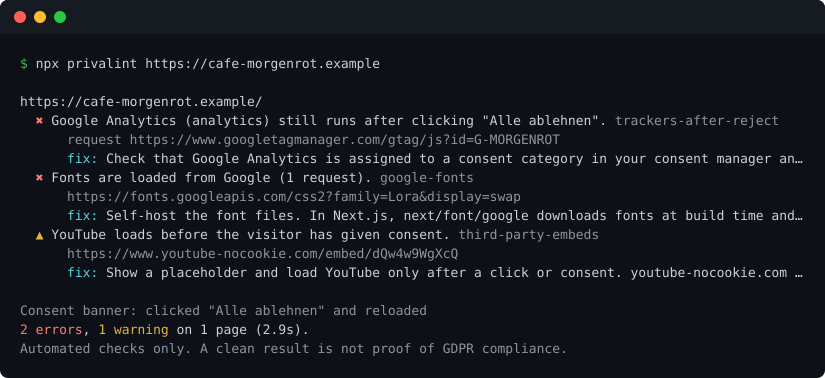

# privalint

[](https://github.com/jexcellence/privalint/actions/workflows/ci.yml)
[](https://www.npmjs.com/package/privalint)
[](LICENSE)

**Deutsch:** [README.de.md](README.de.md)

Lint your website for the GDPR mistakes that get people warning letters: trackers that fire before
consent or keep running after "reject", Google Fonts loaded from Google, embeds and a missing
Impressum.

privalint opens your site in a real Chromium browser with no cookies or storage, like a first
visit. It records what loads before anyone touches the consent banner, then clicks "reject" and
checks what still loads. Run it from your terminal or as a GitHub Action on every pull request.

```bash
npx privalint https://your-site.de
```

<p align="center">
  
</p>

<sub>Output for the demo page in <a href="test/fixtures/demo/index.html"><code>test/fixtures/demo</code></a>, long lines
shortened. Regenerate it with <code>npm run demo</code>.</sub>

> [!IMPORTANT]
> privalint runs automated checks. A clean result means it found none of the problems it looks
> for. It does not make your site GDPR compliant and it is not legal advice.

## What it checks

| Rule                                                           | Severity | What it finds                                                                                                              |
| -------------------------------------------------------------- | -------- | -------------------------------------------------------------------------------------------------------------------------- |
| [`pre-consent-trackers`](docs/rules/pre-consent-trackers.md)   | error    | Analytics, ads and session-replay tools that send requests or set cookies before consent. A bare tag manager is a warning. |
| [`trackers-after-reject`](docs/rules/trackers-after-reject.md) | error    | Trackers that still load after clicking "reject" on the consent banner and reloading.                                      |
| [`reject-option`](docs/rules/reject-option.md)                 | warning  | A banner with "accept" but no "reject" on its first layer. Pay-or-OK banners are noted as info.                            |
| [`google-fonts`](docs/rules/google-fonts.md)                   | error    | Fonts fetched from `fonts.googleapis.com` / `fonts.gstatic.com`. Leftover preconnects are a warning.                       |
| [`adobe-fonts`](docs/rules/adobe-fonts.md)                     | error    | Fonts fetched from Adobe Fonts (`use.typekit.net` / `p.typekit.net`). Leftover preconnects are a warning.                  |
| [`third-party-embeds`](docs/rules/third-party-embeds.md)       | warning  | YouTube, Vimeo, Google Maps, reCAPTCHA, Gravatar and social embeds loading before consent.                                 |
| [`third-party-cdns`](docs/rules/third-party-cdns.md)           | info     | Scripts and styles from jsDelivr, unpkg, cdnjs and other public CDNs.                                                      |
| [`impressum-link`](docs/rules/impressum-link.md)               | warning  | Pages without a link to an Impressum. A contact link alone is noted as info.                                               |
| [`privacy-policy-link`](docs/rules/privacy-policy-link.md)     | warning  | Pages without a link to a privacy policy.                                                                                  |

More rules are on the [roadmap](#roadmap). Each one is a small file with tests, see
[CONTRIBUTING.md](CONTRIBUTING.md).

## GitHub Action

```yaml
name: Privacy

on:
  pull_request:
  schedule:
    - cron: "0 6 * * 1"

jobs:
  privalint:
    runs-on: ubuntu-latest
    permissions:
      contents: read
      security-events: write # only needed for the SARIF upload
    steps:
      - uses: jexcellence/privalint@v0
        with:
          url: https://your-site.de
          max-pages: 20

      - uses: github/codeql-action/upload-sarif@v4
        if: always()
        with:
          sarif_file: privalint.sarif
          category: privalint
```

The report shows up in the job summary. With the SARIF upload, findings also appear under
**Security → Code scanning**.

To create/update a PR comment, set `pr-comment: true` and grant the job `pull-requests: write`.
The action updates its own marked bot comment. Fork PRs and read-only tokens skip commenting
without failing the scan. Reports are posted even when findings make the scan step fail.
See [configuration and report APIs](docs/configuration.md) ([Deutsch](docs/configuration.de.md)).

Scanning a preview deployment instead of production catches problems before they ship. Pass the
preview URL from your hosting provider's deployment event or action output as `url`.

| Input                | Default           |                                                       |
| -------------------- | ----------------- | ----------------------------------------------------- |
| `url`                |                   | Page to scan. Required.                               |
| `max-pages`          | `1`               | How many pages of the same site to crawl.             |
| `fail-on`            | `error`           | `error`, `warning` or `never`.                        |
| `fail-on-incomplete` | `false`           | Fail separately for incomplete required observations. |
| `disable`            |                   | Comma-separated rule ids to skip.                     |
| `lang`               | `en`              | Language of the report: `en` or `de`.                 |
| `region`             | `de`              | Whose law to cite: `de`, `at`, `ch`, `eu`.            |
| `sarif-file`         | `privalint.sarif` | Where to write SARIF. Empty to skip.                  |
| `job-summary`        | `true`            | Add the Markdown report to the job summary.           |
| `pr-comment`         | `false`           | Create/update a same-repository PR report comment.    |

Outputs: `exit-code`, and `sarif-file` when a report was written.

The action uses the runner's Node.js (20.12 or newer) and leaves your job's Node version alone.
On self-hosted runners without it, add `actions/setup-node` before this step.

> [!NOTE]
> Code scanning expects each finding to point at a file in your repository, which a live page
> doesn't have. privalint maps every page to a stable path such as `privalint/your-site.de/kontakt`.
> Alerts show up with message, evidence and fix, but there is no source file to jump to. The
> [demo scan](.github/workflows/demo.yml) runs this setup every week.

## CLI

```
privalint <url> [options]

  -p, --max-pages <n>     Crawl up to n pages of the same site (default 1)
  -f, --format <format>   text | json | markdown | sarif (default text)
  -o, --output <file>     Write the report to a file and print a text summary.
                          Repeatable; .sarif, .json and .md pick their format,
                          other extensions use --format
      --fail-on <level>   error | warning | never (default error)
      --fail-on-incomplete  Exit 3 for incomplete required observations (opt-in)
      --allow-incomplete    Override failOnIncomplete from JSON config
      --config <file>     Select a JSON configuration file
      --disable <rules>   Comma-separated rule ids to skip
      --settle <ms>       Wait this long after load for late tags (default 2000)
      --timeout <ms>      Navigation timeout per page (default 30000)
      --locale <locale>   Browser locale (default de-DE)
      --lang <lang>       Language of the report: en | de (default en)
      --region <region>   Whose law to cite: de | at | ch | eu (default de)
      --skip-consent      Don't click "reject" on the consent banner
      --headed            Open a visible browser window instead of running headless
      --channel <name>    Use an installed browser: chrome or msedge
      --list-rules        Print the available rules and exit
```

Exit codes: `0` nothing at or above `--fail-on`, `1` findings, `2` bad arguments or a failed scan.
With `--fail-on-incomplete`, exit `3` means incomplete required observation. Findings exit `1`
takes precedence; intentional disabled-rule/consent exclusions are ignored by this gate.

The first run needs a browser. If Playwright hasn't installed one yet:

```bash
npx playwright install chromium
```

## Countries and languages

`--region` selects the references and severity profile used by the tool. It does not determine
which law applies to a website, and findings are not legal determinations:

| Region         | Cookies and tracking                 | Imprint                               | Changes                                                                          |
| -------------- | ------------------------------------ | ------------------------------------- | -------------------------------------------------------------------------------- |
| `de` (default) | Opt-in, § 25 TDDDG                   | § 5 DDG                               | none                                                                             |
| `at`           | Opt-in, § 165 Abs. 3 TKG 2021        | § 5 ECG, § 25 MedienG                 | none                                                                             |
| `ch`           | Opt-out, Art. 45c FMG                | Art. 3 Abs. 1 lit. s UWG (e-commerce) | `pre-consent-trackers`, `third-party-embeds` and `impressum-link` drop one level |
| `eu`           | Opt-in, Art. 5(3) ePrivacy Directive | Art. 5 Directive 2000/31/EC           | none                                                                             |

Every finding lists its legal basis for the chosen country. Trackers that run after an explicit
"reject" stay an error everywhere, Switzerland included (Art. 30 Abs. 2 lit. b DSG). If a Swiss
site also targets visitors in the EU, scan it with `--region eu` as well.

`--lang de` writes findings, fixes and the report in German:

```bash
npx privalint https://ihre-seite.ch --region ch --lang de
```

## Use it from code

CLI configuration is loaded from `privalint.config.json` when present, or `--config <file>`.
CLI flags override JSON settings. API callers pass `ruleSettings` and `allow` explicitly;
the API never loads a config file implicitly. Allowed vendors remain visible as info with a policy
annotation; allowlisting does not establish consent or legal approval.

```json
{
  "url": "https://example.org",
  "maxPages": 20,
  "rules": { "third-party-cdns": "warning", "impressum-link": "off" },
  "allow": { "vendors": ["Google Analytics"] }
}
```

```ts
import { scan } from 'privalint';

const result = await scan('https://your-site.de', { maxPages: 10, region: 'at', lang: 'de' });
for (const finding of result.findings) {
  console.log(finding.severity, finding.ruleId, finding.pageUrl);
}
```

New reports carry `schemaVersion`, `scannerVersion` and normalized `options`. An absent
schema version means a legacy report, not version 1. `ruleEvaluations[].outcome` explicitly
distinguishes `checked-no-finding`, `finding-detected` and `not-evaluable`, always with a fixed
`explanation` code. `onProgress` emits real stages (`starting`, `loading-page`, `checking-consent`,
`evaluating-rules`, `completed`) with elapsed time and redacted page URLs; it does not invent a
percentage. The CLI and Action keep their existing finding-threshold exit policy.

Schema 1.1.0 adds random scan/page IDs and explicit capture-to-page progress resolution, so redacted
pages remain distinguishable. Standalone schemas and complete/partial/skip/policy fixtures are
included. The [report contract and optional CI gate](docs/report-contract.md)
([Deutsch](docs/report-contract.de.md)) explain validation and identity/exit-code semantics.

### Public web scanners and controlled capture

`scan()` accepts a `networkAdapter` and `AbortSignal`. The adapter receives each HTTP hop,
including redirects, and returns a response or throws a typed `NetworkError`. Requests wait
in a FIFO queue; concurrency, request count, response bytes and timeouts are independent limits.
There is no browser HTTP fallback in adapter mode.

The scanner owns its browser and fresh contexts and closes them on completion or cancellation.
The caller owns the adapter's shared clients. Keep your existing egress policy: validate and pin
DNS/socket destinations for **every** hop, and honour the provided per-request abort signal.

See the [controlled scanner guide](docs/controlled-scanner.md) and the type-checked
[pinned-transport example](examples/controlled-scanner.ts). The example denies origins absent
from a trusted deployment allowlist and pins socket addresses; the allowlist must not come from
the person submitting the scan.

Reports separate `findings` from `pages[].capture.diagnostics`. A page with 48 requests and 21
blocked/failed requests is marked incomplete even if no findings were produced. Per-page
`ruleEvaluations` distinguish `executed`, `skipped` and `not-evaluable`; positive evidence may
still be evaluated with `partial: true`. No banner detected is not itself a privacy finding,
and does not mean that the reject path was tested.

Existing CLI, API and GitHub Action calls still work. Start-page navigation failures retain the
legacy throw behaviour unless `failureMode: 'report'` is selected (the default with an adapter).
No report claims legal compliance.

## How it works

1. Every page is opened in a **fresh browser context**: no cookies and no storage, the same as a
   first visit.
2. privalint waits for the network to go idle plus a settle delay (`--settle`), so tags that load
   late are caught too.
3. It records every request, the final cookie jar, all links and `<link>` resource hints.
4. On the start page it looks for the consent banner, either by the selectors of common consent
   managers (OneTrust, Cookiebot, Usercentrics, Borlabs, Complianz and others) or by button labels
   in six languages. It clicks "reject", reloads and records what still loads.
5. Each rule looks at those snapshots and reports findings with evidence and a suggested fix.
6. With `--max-pages`, links to the same site are followed breadth-first. Query strings are
   dropped, pages are deduplicated after redirects, and pages that fail to load (downloads,
   timeouts) are listed but don't stop the crawl.

### Limitations

- Some sites don't show their consent banner to headless browsers. privalint then reports
  "no banner found" and skips the reject check. Run it locally with `--headed` to scan in a
  visible window; with `--channel msedge` or `--channel chrome` it uses your installed browser
  instead of the bundled one. privalint never disguises itself as a different browser.
- Some sites block automated browsers completely and serve a block page instead. privalint scans
  what it gets, so check the scanned URL and the page count in the report.
- Only "reject" is tested. Whether "accept" works, and whether rejecting is as easy as accepting
  beyond the presence of a button, is not judged.
- Tracker detection uses a hand-maintained list ([`src/data/trackers.ts`](src/data/trackers.ts)).
  A vendor missing from the list goes unnoticed. Additions are very welcome.
- First-party detection compares hostnames and ignores the public suffix list, so sibling
  subdomains on shared hosts like `*.github.io` count as first party.
- Server-side tracking can't be seen from the browser.
- Many consent managers decide by IP address whether to show a banner. GitHub-hosted runners
  have US addresses, so some sites load trackers there that EU visitors never get, and the
  result differs from what an EU visitor sees. Use a runner or proxy in the EU for results you
  want to rely on.
- Chromium is launched with Playwright's defaults, which turn off the Chromium sandbox. Don't
  scan sites you don't trust on a machine that holds secrets.

## Roadmap

- PR comments from the Action
- Config migration helpers and report comparison (JSON config is available now)
- Check the settings layer of banners and the "accept" path
- More trackers, embeds and consent managers (see the
  [`good first issue`](https://github.com/jexcellence/privalint/labels/good%20first%20issue) label)
- Larger tracker list built from the Apache-licensed
  [Open Cookie Database](https://github.com/jkwakman/Open-Cookie-Database)

## Contributing

Bug reports, false positives, new trackers and new rules are all welcome. Start with
[CONTRIBUTING.md](CONTRIBUTING.md).

## License

[MIT](LICENSE)
