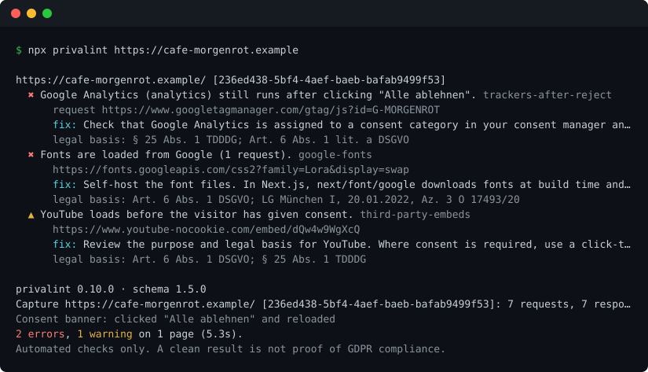

# privalint

[](https://github.com/jexcellence/privalint/actions/workflows/ci.yml)
[](https://www.npmjs.com/package/privalint)
[](https://github.com/marketplace/actions/privalint)
[](LICENSE)
[](https://github.com/jexcellence/privalint/labels/good%20first%20issue)

**Deutsch:** [README.de.md](README.de.md)

Lint your website for the GDPR mistakes that get people warning letters: trackers that fire before
consent or keep running after "reject", fonts loaded from Google or Adobe, embeds before consent,
a banner you can't reopen, and a missing Impressum.

privalint opens your site in a real Chromium browser with no cookies or storage, like a first
visit. It records what loads before anyone touches the consent banner, then clicks "reject" and
checks what still loads. Run it from your terminal or as a GitHub Action on every pull request.

```bash
npx privalint https://your-site.de
```

<p align="center">
  
</p>

<sub>Output for the demo page in <a href="test/fixtures/demo/index.html"><code>test/fixtures/demo</code></a>, long lines
shortened. Regenerate it with <code>npm run demo</code>.</sub>

> [!IMPORTANT]
> privalint runs automated checks. A clean result means it found none of the problems it looks
> for. It does not make your site GDPR compliant and it is not legal advice.

## What it checks

| Rule                                                                   | Severity | What it finds                                                                                                                                                     |
| ---------------------------------------------------------------------- | -------- | ----------------------------------------------------------------------------------------------------------------------------------------------------------------- |
| [`pre-consent-trackers`](docs/rules/pre-consent-trackers.md)           | error    | Analytics, ads and session-replay tools that send requests or set cookies before consent. A bare tag manager is a warning.                                        |
| [`trackers-after-reject`](docs/rules/trackers-after-reject.md)         | error    | Trackers that still load after clicking "reject" on the consent banner and reloading.                                                                             |
| [`trackers-after-settings`](docs/rules/trackers-after-settings.md)     | error    | Opt-in (`--check-settings`): trackers that still load after switching off every category in the banner settings and saving.                                       |
| [`consent-preselected`](docs/rules/consent-preselected.md)             | error    | Opt-in (`--check-settings`): optional categories already switched on when the banner settings open.                                                               |
| [`trackers-after-close`](docs/rules/trackers-after-close.md)           | error    | Opt-in (`--check-close`): trackers that load after the banner was closed with its "×" button.                                                                     |
| [`reject-option`](docs/rules/reject-option.md)                         | warning  | A banner with "accept" but no "reject" on its first layer. Pay-or-OK banners are noted as info.                                                                   |
| [`reject-less-prominent`](docs/rules/reject-less-prominent.md)         | info     | A reject control shown as plain text, much smaller, or with much lower contrast than the accept button.                                                           |
| [`banner-language`](docs/rules/banner-language.md)                     | info     | A consent banner in another language than the page.                                                                                                               |
| [`consent-banner-missing`](docs/rules/consent-banner-missing.md)       | warning  | Trackers run and no consent banner was found at all, so visitors can't give or refuse consent.                                                                    |
| [`banner-legal-links`](docs/rules/banner-legal-links.md)               | warning  | A banner that blocks the page and links neither the privacy policy nor the Impressum.                                                                             |
| [`consent-settings-link`](docs/rules/consent-settings-link.md)         | warning  | No visible link or button to reopen the cookie settings after rejecting.                                                                                          |
| [`google-fonts`](docs/rules/google-fonts.md)                           | error    | Fonts fetched from `fonts.googleapis.com` / `fonts.gstatic.com`. Leftover preconnects are a warning.                                                              |
| [`adobe-fonts`](docs/rules/adobe-fonts.md)                             | error    | Fonts fetched from Adobe Fonts (`use.typekit.net` / `p.typekit.net`). Leftover preconnects are a warning.                                                         |
| [`third-party-embeds`](docs/rules/third-party-embeds.md)               | warning  | YouTube, Vimeo, Google Maps, reCAPTCHA, Gravatar, social embeds and chat/review widgets such as Intercom before consent.                                          |
| [`third-party-cdns`](docs/rules/third-party-cdns.md)                   | info     | Scripts and styles from jsDelivr, unpkg, cdnjs and other public CDNs.                                                                                             |
| [`third-country-providers`](docs/rules/third-country-providers.md)     | info     | Error monitoring, backends and similar services outside the EU/EEA, such as Sentry in the US, contacted before consent.                                           |
| [`third-party-personal-data`](docs/rules/third-party-personal-data.md) | warning  | Requests to other sites that carry e-mail addresses or phone numbers, plain or hashed. Values are never reported.                                                 |
| [`tracking-cookie-lifetime`](docs/rules/tracking-cookie-lifetime.md)   | info     | Tracking cookies that last longer than 13 months.                                                                                                                 |
| [`impressum-link`](docs/rules/impressum-link.md)                       | warning  | Pages without a link to an Impressum. A contact link alone is noted as info.                                                                                      |
| [`legal-notice-content`](docs/rules/legal-notice-content.md)           | warning  | A linked legal notice without a postal address or e-mail address. A registered company without a register entry is noted as info.                                 |
| [`privacy-policy-link`](docs/rules/privacy-policy-link.md)             | warning  | Pages without a link to a privacy policy.                                                                                                                         |
| [`privacy-policy-vendors`](docs/rules/privacy-policy-vendors.md)       | warning  | Trackers and cookie-setting embeds the start page uses that the privacy policy doesn't name. Fonts, CDNs and other services are info.                             |
| [`privacy-policy-content`](docs/rules/privacy-policy-content.md)       | warning  | A privacy policy without an e-mail or postal address of the controller, or with template placeholders. A data protection officer without contact details is info. |
| [`form-privacy-notice`](docs/rules/form-privacy-notice.md)             | info     | Contact, sign-up or login forms without a privacy-policy link next to them.                                                                                       |
| [`https-transport`](docs/rules/https-transport.md)                     | error    | The start page over plain HTTP; HTTP without a redirect to HTTPS is a warning, no HSTS is info.                                                                   |
| [`form-preticked-consent`](docs/rules/form-preticked-consent.md)       | warning  | Forms that tick a newsletter or advertising consent box in advance.                                                                                               |
| [`mixed-content`](docs/rules/mixed-content.md)                         | error    | HTTPS pages with a form that submits over HTTP. Resources over HTTP are info.                                                                                     |
| [`referrer-policy`](docs/rules/referrer-policy.md)                     | info     | A referrer policy that sends full page addresses to other sites.                                                                                                  |
| [`withdrawal-button`](docs/rules/withdrawal-button.md)                 | warning  | Online shops without a "withdraw from contract here" link on the start page (required since 19.06.2026).                                                          |
| [`accessibility-statement`](docs/rules/accessibility-statement.md)     | info     | Online shops without a link to accessibility information (European Accessibility Act).                                                                            |

Each rule is a small file with tests. Missing a check? See [Contributing](#contributing).

## GitHub Action

```yaml
name: Privacy

on:
  pull_request:
  schedule:
    - cron: "0 6 * * 1"

jobs:
  privalint:
    runs-on: ubuntu-latest
    permissions:
      contents: read
      security-events: write # only needed for the SARIF upload
    steps:
      - uses: jexcellence/privalint@v0
        with:
          url: https://your-site.de
          max-pages: 20
          concurrency: 3

      - uses: github/codeql-action/upload-sarif@v4
        if: always()
        with:
          sarif_file: privalint.sarif
          category: privalint
```

The report shows up in the job summary. With the SARIF upload, findings also appear under
**Security → Code scanning**.

To create/update a PR comment, set `pr-comment: true` and grant the job `pull-requests: write`.
The action updates its own marked bot comment. Fork PRs and read-only tokens skip commenting
without failing the scan. Reports are posted even when findings make the scan step fail.
See [configuration and report APIs](docs/configuration.md) ([Deutsch](docs/configuration.de.md)).

Scanning a preview deployment instead of production catches problems before they ship. Pass the
preview URL from your hosting provider's deployment event or action output as `url`.

Inputs left empty are not passed to privalint, so `privalint.config.json` in your workspace (or
`config`) decides, and the CLI default applies when neither sets a value.

| Input                | Default              |                                                                                |
| -------------------- | -------------------- | ------------------------------------------------------------------------------ |
| `url`                |                      | Page to scan. Required.                                                        |
| `config`             |                      | JSON config file. Empty reads `./privalint.config.json` if present.            |
| `max-pages`          | config, else `1`     | How many pages of the same site to crawl.                                      |
| `concurrency`        | config, else `1`     | Pages loaded at the same time; same report as with 1.                          |
| `fail-on`            | `error`              | `error`, `warning` or `never`.                                                 |
| `fail-on-incomplete` | config, else off     | `true` or `false`: fail separately for incomplete observations.                |
| `check-settings`     | config, else off     | `true` also tests the banner's settings layer.                                 |
| `check-close`        | config, else off     | `true` also closes the banner with its close button and checks what loads.     |
| `sitemap`            | config, else off     | `true` chooses pages from `sitemap.xml`, pages with forms first.               |
| `device`             | config, else desktop | Playwright device to emulate, such as `iPhone 15`, to check the mobile banner. |
| `disable`            |                      | Comma-separated rule ids to skip.                                              |
| `lang`               | config, else `en`    | Language of the report: `en`, `de` or `hu`.                                    |
| `region`             | config, else `de`    | Whose law to cite: `de`, `at`, `ch`, `hu`, `eu`.                               |
| `sarif-file`         | `privalint.sarif`    | Where to write SARIF. Empty to skip.                                           |
| `job-summary`        | `true`               | Add the Markdown report to the job summary.                                    |
| `pr-comment`         | `false`              | Create/update a same-repository PR report comment.                             |

Outputs: `exit-code`, and `sarif-file` when a report was written.

The action uses the runner's Node.js (20.12 or newer) and leaves your job's Node version alone.
On self-hosted runners without it, add `actions/setup-node` before this step.

> [!NOTE]
> Code scanning expects each finding to point at a file in your repository, which a live page
> doesn't have. privalint maps every page to a stable path such as `privalint/your-site.de/kontakt`.
> Alerts show up with message, evidence and fix, but there is no source file to jump to. The
> [demo scan](.github/workflows/demo.yml) runs this setup every week.

## CLI

```
privalint <url> [options]

  -p, --max-pages <n>     Crawl up to n pages of the same site (default 1)
      --concurrency <n>   Load up to n pages at the same time (default 1).
                          The report is the same as with 1
  -f, --format <format>   text | json | markdown | sarif (default text)
  -o, --output <file>     Write the report to a file and print a text summary.
                          Repeatable; .sarif, .json and .md pick their format,
                          other extensions use --format
      --evaluations <mode>  full | summary (default full). summary leaves the
                          per-page rule results out of JSON; the per-rule
                          summary stays
      --fail-on <level>   error | warning | never (default error)
      --fail-on-incomplete  Exit 3 for incomplete required observations (opt-in)
      --allow-incomplete    Override failOnIncomplete from JSON config
      --config <file>     Select a JSON configuration file
      --disable <rules>   Comma-separated rule ids to skip
      --settle <ms>       Wait this long after load for late tags (default 2000)
      --timeout <ms>      Navigation timeout per page (default 30000)
      --locale <locale>   Browser locale (default de-DE)
      --lang <lang>       Language of the report: en | de | hu (default en)
      --region <region>   Whose law to cite: de | at | ch | hu | eu (default de)
      --skip-consent      Don't click "reject" on the consent banner
      --check-settings    Also open the banner's settings, switch everything off and
                          save, then check what still loads (loads the start page again)
      --check-close       Also close the banner with its "×" button, reload and check
                          whether that counts as consent (loads the start page again)
      --host-checks <mode>  each | main (default each). each also runs the consent,
                          banner and HTTPS checks on the first page of up to five
                          other hosts of the site, such as docs. or blog.
      --sitemap           Choose the pages to scan from sitemap.xml, spread over the site
                          and pages with forms first, instead of only following links
      --device <name>     Emulate a Playwright device, such as "iPhone 15" or "Pixel 7":
                          viewport, user agent and touch, to see mobile banners
      --headed            Open a visible browser window instead of running headless
      --channel <name>    Use an installed browser: chrome or msedge
      --sandbox           Run Chromium with its sandbox (recommended for untrusted
                          sites; may not start in containers)
      --list-rules        Print the available rules and exit
```

Exit codes: `0` nothing at or above `--fail-on`, `1` findings, `2` bad arguments or a failed scan.
With `--fail-on-incomplete`, exit `3` means incomplete required observation. Findings exit `1`
takes precedence; intentional disabled-rule/consent exclusions are ignored by this gate.

The first run needs a browser. If Playwright hasn't installed one yet:

```bash
npx playwright install chromium
```

## Countries and languages

`--region` selects the references and severity profile used by the tool. It does not determine
which law applies to a website, and findings are not legal determinations:

| Region         | Cookies and tracking                 | Imprint                               | Changes                                                     |
| -------------- | ------------------------------------ | ------------------------------------- | ----------------------------------------------------------- |
| `de` (default) | Opt-in, § 25 TDDDG                   | § 5 DDG                               | none                                                        |
| `at`           | Opt-in, § 165 Abs. 3 TKG 2021        | § 5 ECG, § 25 MedienG                 | none                                                        |
| `ch`           | Opt-out, Art. 45c FMG                | Art. 3 Abs. 1 lit. s UWG (e-commerce) | trackers, embeds, fonts and `impressum-link` drop one level |
| `hu`           | Opt-in, Eht. 155. § (4)              | Ekertv. 4. §                          | none                                                        |
| `eu`           | Opt-in, Art. 5(3) ePrivacy Directive | Art. 5 Directive 2000/31/EC           | none                                                        |

Every finding lists its legal basis for the chosen country. Trackers that run after an explicit
"reject" stay an error everywhere, Switzerland included (Art. 30 Abs. 2 lit. b DSG). If a Swiss
site also targets visitors in the EU, scan it with `--region eu` as well.

`--lang de` writes findings, fixes and the report in German:

```bash
npx privalint https://ihre-seite.ch --region ch --lang de
```

`--lang hu` does the same in Hungarian, usually together with the Hungarian legal profile:

```bash
npx privalint https://pelda.hu --region hu --lang hu
```

## Use it from code

CLI configuration is loaded from `privalint.config.json` when present, or `--config <file>`.
CLI flags override JSON settings. API callers pass `ruleSettings` and `allow` explicitly;
the API never loads a config file implicitly. Allowed vendors remain visible as info with a policy
annotation; allowlisting does not establish consent or legal approval.

```json
{
  "url": "https://example.org",
  "maxPages": 20,
  "rules": { "third-party-cdns": "warning", "impressum-link": "off" },
  "allow": { "vendors": ["Google Analytics"] }
}
```

```ts
import { scan } from 'privalint';

const result = await scan('https://your-site.de', { maxPages: 10, region: 'at', lang: 'de' });
for (const finding of result.findings) {
  console.log(finding.severity, finding.ruleId, finding.pageUrl);
}
```

Every report says for each rule and page whether it was checked with no finding, found something,
or could not be checked, and why. That keeps "nothing found" apart from "not looked at".

Going further:

- [Report contract and the optional coverage gate](docs/report-contract.md): JSON schema,
  versioning, exit codes
- [Running privalint behind a public web form](docs/controlled-scanner.md): network adapter,
  limits and cancellation, with a [type-checked example](examples/controlled-scanner.ts)
- [Configuration reference](docs/configuration.md)

## How it works

1. Every page is opened in a **fresh browser context**: no cookies and no storage, the same as a
   first visit.
2. privalint waits for the network to go idle plus a settle delay (`--settle`), so tags that load
   late are caught too.
3. It records every request, the final cookie jar, all links and `<link>` resource hints.
4. On the start page it looks for the consent banner, either by the selectors of common consent
   managers (OneTrust, Cookiebot, Usercentrics, Borlabs, Complianz and others) or by button labels
   in six languages. If none is there yet, it keeps looking for up to one more settle period,
   since some consent managers render late. It clicks "reject", reloads, records what still loads
   and checks that the settings can be reopened.
5. Each rule looks at those snapshots and reports findings with evidence and a suggested fix.
6. With `--max-pages`, links to the same site are followed breadth-first. Query strings are
   dropped, except the parameters that select a page on `/` and `*.php` (`page_id`, `p`, `id`,
   `cat`, `page`, `lang`, as on WordPress without pretty permalinks). Pages are deduplicated after
   redirects, and pages that fail to load (downloads, timeouts) are listed but don't stop the
   crawl.
   "Same site" means the same registrable domain from the
   [public suffix list](https://publicsuffix.org/), so `shop.example.co.uk` belongs to
   `example.co.uk`, but `a.github.io` and `b.github.io` are different sites. IP addresses and
   `localhost` only match themselves. The list ships with the
   [tldts](https://github.com/remusao/tldts) dependency, so nothing is looked up during a scan,
   and it is updated by updating that dependency.

### Limitations

- Some sites don't show their consent banner to headless browsers. privalint then reports
  "no banner found" and skips the reject check. Run it locally with `--headed` to scan in a
  visible window; with `--channel msedge` or `--channel chrome` it uses your installed browser
  instead of the bundled one. privalint never disguises itself as a different browser.
- Some sites block automated browsers completely and serve a block page instead. privalint scans
  what it gets, so check the scanned URL and the page count in the report.
- Only "reject" is tested. Whether "accept" works, and whether rejecting is as easy as accepting
  beyond the presence of a button, is not judged.
- Tracker detection uses a hand-maintained list ([`src/data/trackers.ts`](src/data/trackers.ts)).
  A vendor missing from the list goes unnoticed. Additions are very welcome. Cookies the list
  doesn't know are also looked up in analytics and marketing cookies from the
  [Open Cookie Database](https://github.com/jkwakman/Open-Cookie-Database) (Apache-2.0, see
  [NOTICE](NOTICE)). That data only matches cookie names, never request hosts, and leaves out
  short, generic and consent-related names.
- Server-side tracking can't be seen from the browser.
- Many consent managers decide by IP address whether to show a banner. GitHub-hosted runners
  have US addresses, so some sites load trackers there that EU visitors never get, and the
  result differs from what an EU visitor sees. Use a runner or proxy in the EU for results you
  want to rely on.
- Chromium runs without its sandbox by default, like Playwright's own default, because the
  sandbox often can't start in containers. Pass `--sandbox` when you scan sites you don't trust
  on a machine that holds secrets. The sandbox needs unprivileged user namespaces. Docker's
  default seccomp profile blocks them inside containers, and on Ubuntu 23.10 and later AppArmor
  restricts them unless Chromium is allowed to use them.

## Roadmap

- Report comparison between two scans

## Contributing

privalint gets better with every tracker, consent manager and false positive someone reports.
Most contributions are a few lines of data plus a test, and you don't need to know the whole
codebase. Good places to start:

| Issue                                                                             | What it takes                                 |
| --------------------------------------------------------------------------------- | --------------------------------------------- |
| [#30](https://github.com/jexcellence/privalint/issues/30) Consent managers        | Find two button selectors on a real site      |
| [#31](https://github.com/jexcellence/privalint/issues/31) Session-replay tools    | Add hosts from the vendor's docs, plus a test |
| [#32](https://github.com/jexcellence/privalint/issues/32) Chat and review widgets | Same, for `third-party-embeds`                |
| [#33](https://github.com/jexcellence/privalint/issues/33) German rule docs        | Translate one page                            |
| [#34](https://github.com/jexcellence/privalint/issues/34) Action input            | One input in `action.yml`                     |
| [#37](https://github.com/jexcellence/privalint/issues/37) Sandbox on Linux/macOS  | Run one command and report back               |

Found a false positive or a tracker privalint missed? The
[issue forms](https://github.com/jexcellence/privalint/issues/new/choose) ask for exactly what's
needed. [CONTRIBUTING.md](CONTRIBUTING.md) covers setup, adding a tracker and writing a rule.

If privalint saved you a warning letter or a review round, a star helps others find it.

## License

[MIT](LICENSE). The cookie data in `src/data/open-cookie-database.ts` comes from the Open Cookie
Database under Apache-2.0; see [NOTICE](NOTICE).
